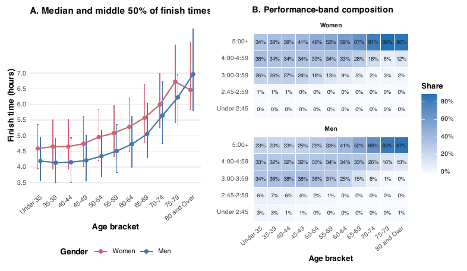
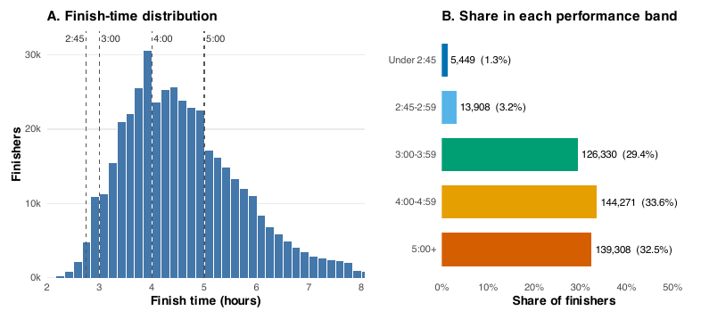

# Visualizing Performance Stratification in 2023 U.S. Marathon Results

An exploratory data-visualization study of **429,266 finisher records from 641 U.S. marathons** in 2023, built in **R (dplyr, tidyr, ggplot2, cowplot)** with a reproducible **Quarto** report.

> Course project for AMOD 5430H Data Visualization, M.Sc. in Applied Modelling & Quantitative Methods, Trent University (Summer 2026).
> Team: Zijian Wang (project coordination), Yuanyuan Zhang, Xiaohan Zhang, Yihe Wang. Full paper: [`Paper/project-paper-final.pdf`](Paper/project-paper-final.pdf)

## Question

Marathon results are usually summarized by one average or a familiar threshold such as "sub-4". How differently are finishers distributed across performance levels once you split by age, gender, race size, month and individual race?

Each finisher is assigned to one of five mutually exclusive performance bands:

| Band | Finish time |
|---|---|
| Elite / near-elite | under 2:45 |
| Sub-3 | 2:45–2:59 |
| Sub-4 | 3:00–3:59 |
| Sub-5 | 4:00–4:59 |
| 5+ hours | 5:00 or slower |

## Key Findings

- The median finish time was **4.46 hours**; **4.5%** of finishers ran under 3 hours and **33.9%** under 4 hours.
- Performance-band shares shift sharply with age and differ between women and men at every age bracket.
- Races of similar size often had very different sub-4 shares, so field size alone does not explain how competitive a race is.
- October and November accounted for **44.2%** of finishers listed in race metadata.





## Figures

The paper includes six reproducible figure groups, generated by `analysis/generate_visualizations.R`:

1. Overall finish-time distribution and performance-band shares
2. Median and interquartile finish times by age bracket and gender, with a performance-band heatmap
3. Race counts and performance composition by race-size group
4. Race size versus sub-4 share, with a descriptive LOESS trend
5. Race and finisher volume by month
6. Competitive-race ranking by sub-3 share, with a minimum field-size rule

## Reproduce

Requires R 4.5 or later:

```r
install.packages(c("cowplot", "dplyr", "ggplot2", "readr", "scales", "tidyr"))
```

**Quick check with the included anonymized sample** (figures go to `outputs/sample-figures/`, for code verification only):

```bash
Rscript analysis/generate_visualizations.R --sample
```

**Full analysis:** download the dataset (see below), unzip `Results.csv` and `Races.csv` into `data/raw/2023-marathon-results/`, then run:

```bash
Rscript analysis/generate_visualizations.R          # writes Paper/figures/
quarto render Paper/project-paper-final.qmd         # optional: rebuild the paper
```

## Data

- **Source:** [2023 Marathon Results](https://www.kaggle.com/datasets/runningwithrock/2023-marathon-results) by Running with Rock on Kaggle, licensed [CC BY 4.0](https://creativecommons.org/licenses/by/4.0/).
- The full dataset is **not redistributed here** because it contains runner names. Download it from Kaggle, for example:

  ```bash
  curl -L --fail -o data/raw/2023-marathon-results/2023-marathon-results.zip \
    "https://www.kaggle.com/api/v1/datasets/download/runningwithrock/2023-marathon-results"
  unzip -o data/raw/2023-marathon-results/2023-marathon-results.zip -d data/raw/2023-marathon-results
  ```

- `data/sample/` holds a small derived sample (up to 20 random results per race, fixed seed) with names replaced by generated IDs. Regenerate it with `Rscript analysis/create_sample_data.R`.
